  <picture>
    <source media="(prefers-color-scheme: dark)" srcset="readme/banner-night.svg">
    <source media="(prefers-color-scheme: light)" srcset="readme/banner-day.svg">
    
  </picture>

I'm an AI Engineer in Melbourne, building AI tools and automation for the group's businesses.

Previously in IT support and systems administration: helpdesk, Microsoft 365 and Active Directory, POS systems, and hardware and network rollouts across retail and factory sites.

  <picture>
    <source media="(prefers-color-scheme: dark)" srcset="profile-garden/garden-night.svg">
    <source media="(prefers-color-scheme: light)" srcset="profile-garden/garden-day.svg">
    
  </picture>

  <picture>
    <source media="(prefers-color-scheme: dark)" srcset="readme/legend-night.svg">
    <source media="(prefers-color-scheme: light)" srcset="readme/legend-day.svg">
    
  </picture>

  <picture>
    <source media="(prefers-color-scheme: dark)" srcset="readme/growing-night.svg">
    <source media="(prefers-color-scheme: light)" srcset="readme/growing-day.svg">
    
  </picture>

  <a href="https://github.com/SmitHunter/HookLine">
    <picture>
      <source media="(prefers-color-scheme: dark)" srcset="readme/packet-hookline-night.svg">
      <source media="(prefers-color-scheme: light)" srcset="readme/packet-hookline-day.svg">
      
    </picture>
  </a>

  <picture>
    <source media="(prefers-color-scheme: dark)" srcset="readme/stack-night.svg">
    <source media="(prefers-color-scheme: light)" srcset="readme/stack-day.svg">
    
  </picture>

  <a href="https://www.linkedin.com/in/hunter-sm/">
    <picture>
      <source media="(prefers-color-scheme: dark)" srcset="readme/footer-night.svg">
      <source media="(prefers-color-scheme: light)" srcset="readme/footer-day.svg">
      
    </picture>
  </a>

<a href="https://www.linkedin.com/in/hunter-sm/">LinkedIn</a>

