  <picture>
    <source media="(prefers-color-scheme: dark)" srcset="readme/banner-night.svg">
    <source media="(prefers-color-scheme: light)" srcset="readme/banner-day.svg">
    
  </picture>

I'm an AI Engineer in Melbourne, building AI tools and automation for the group's businesses.

Previously in IT support and systems administration: helpdesk, Microsoft 365 and Active Directory, POS systems, and hardware and network rollouts across retail and factory sites.

  <picture>
    <source media="(prefers-color-scheme: dark)" srcset="profile-garden/garden-night.svg">
    <source media="(prefers-color-scheme: light)" srcset="profile-garden/garden-day.svg">
    
  </picture>

My GitHub activity as a garden, redrawn daily by <a href="https://github.com/SmitHunter/profile-garden">a renderer I built</a>. Each plant is a day: bare soil · sprout · seedling · growing · harvest.

<!-- seed-packets:start -->

  <a href="https://github.com/SmitHunter/HookLine">
    <picture>
      <source media="(prefers-color-scheme: dark)" srcset="readme/packet-hookline-night.svg">
      <source media="(prefers-color-scheme: light)" srcset="readme/packet-hookline-day.svg">
      
    </picture>
  </a>
  <a href="https://github.com/SmitHunter/adscout">
    <picture>
      <source media="(prefers-color-scheme: dark)" srcset="readme/packet-adscout-night.svg">
      <source media="(prefers-color-scheme: light)" srcset="readme/packet-adscout-day.svg">
      
    </picture>
  </a>
  <a href="https://github.com/SmitHunter/gig-radar">
    <picture>
      <source media="(prefers-color-scheme: dark)" srcset="readme/packet-gig-radar-night.svg">
      <source media="(prefers-color-scheme: light)" srcset="readme/packet-gig-radar-day.svg">
      
    </picture>
  </a>

<!-- seed-packets:end -->

<b>Stack:</b> Python · TypeScript · JavaScript · Claude API · MCP · Next.js · Astro · Flask · Godot · Cloudflare Workers · Supabase

<a href="https://www.linkedin.com/in/hunter-sm/">LinkedIn</a>

